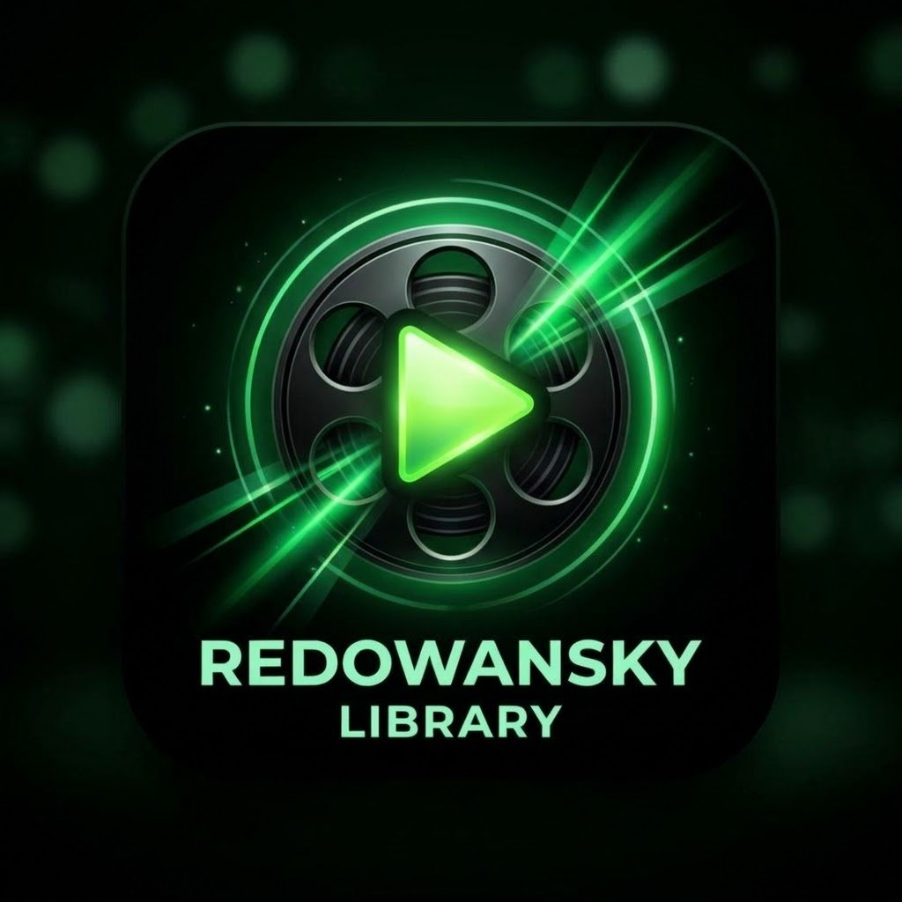

# Redowansky Library — Android app



A native Android app for [redowansky.bond](https://redowansky.bond) — movies
and video songs, streaming free. Catalog comes from the site's own JSON API
(`GET /api/movies`). Native poster grid + search + Movies/Songs filters, a
native detail screen, and a native MPV player (aniyomi-mpv-lib — the same
engine Aniyomi uses; the stock VideoView played sound-only on the library's
HEVC/hvc1 titles), with tap/double-tap-seek controls and resume.

- Package: `app.pepper.library` · minSdk 26, targetSdk 34 · arm64-v8a only
  (native mpv libs)
- Google Sign-In + cross-device watch-progress sync with the site (same
  Google account on phone and PC browser)
- Continue Watching + Recently Played, in-app updates
- **Downloads live inside the app's own private storage** — a 📁 Downloads
  folder in the Recent section, playable offline, deletable from the app.
  Nothing goes to the phone's public Downloads folder.
- Ads: Mondiad banner on home/detail, a fullscreen ad before downloads,
  and Mondiad push (zone 83417). The app's Banner zone is 83566.

## Build (manual, no Gradle — Gradle does not work on the build machine)

```
app/build.sh
```

Pipeline: aapt2 compile/link (app res + Mondiad SDK res merged) →
`gen_lib_r.py` emits library R classes → kotlinc → d8 → zipalign → apksigner.

Dependencies (public Maven artifacts — **not committed here**, fetch them
before building; `app/build.sh` expects them under `app/prebuilt/`):

- aniyomi-mpv-lib 1.18.n (github.com/aniyomiorg/aniyomi-mpv-lib release
  AAR) — classes + arm64 jni libs, cacert/subfont assets in `app/assets/`
- Mondiad Android SDK 1.1.0 (`com.mndiad:android-sdk`, Maven Central)
- AndroidX Core + Core-KTX 1.13.1, kotlinx-coroutines 1.8.1, kotlin-stdlib

Signing uses a dedicated keystore that is **not** in this repo — losing it
means updates can't install over the top.

## Notes

- The APK distributed through the app's own updater is the installable
  build; this repo is the source.
- No passwords, client secrets, or signing keys are committed here. The
  Firebase API key and Google OAuth client IDs in `app/res/values/` are
  app identifiers, not login secrets.
